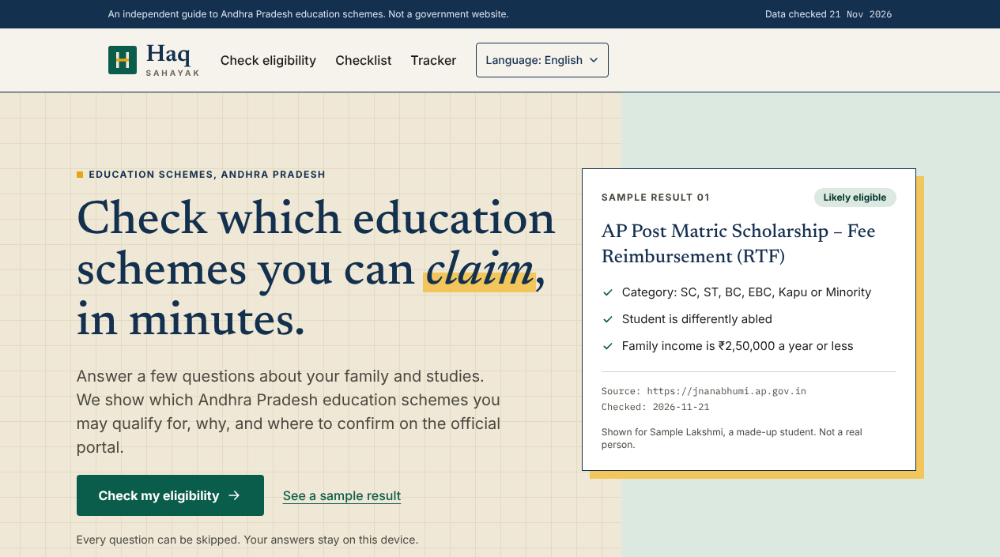
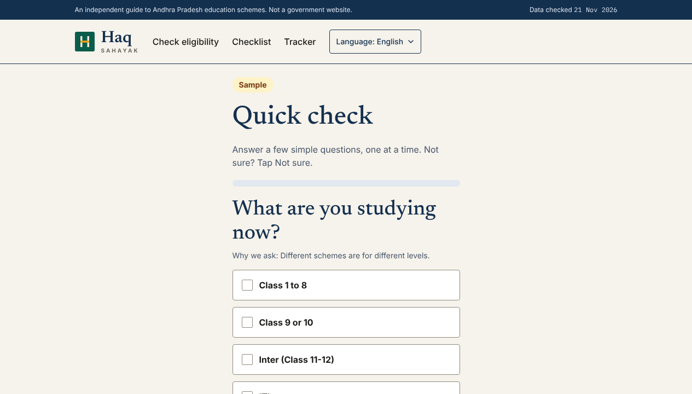
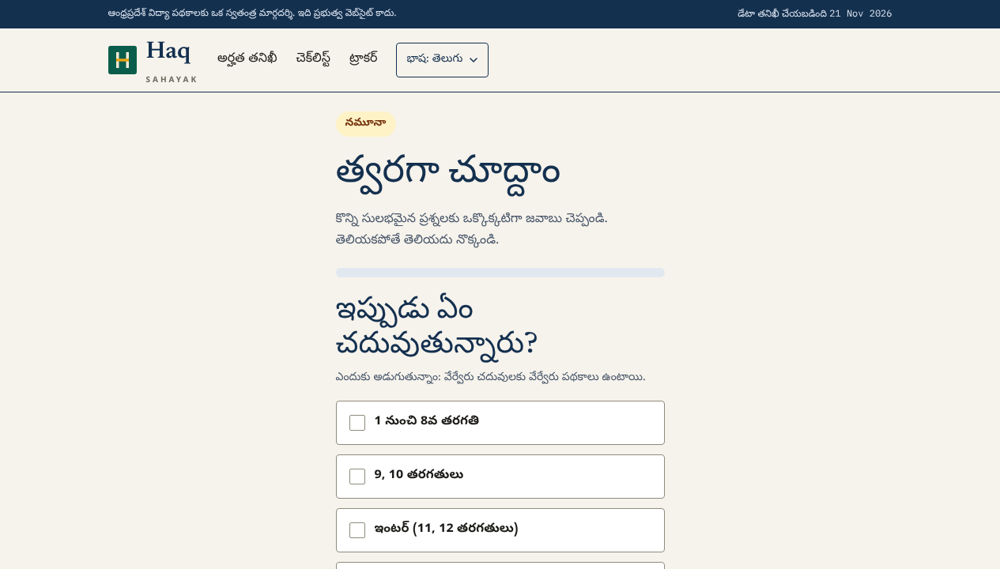
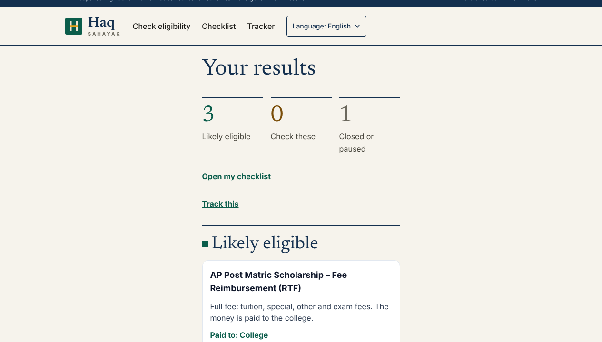
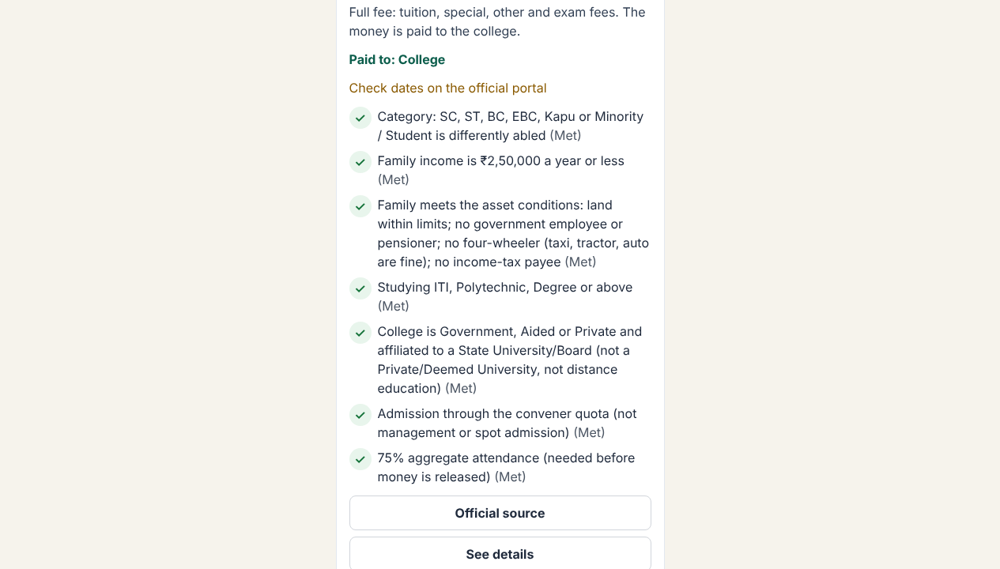
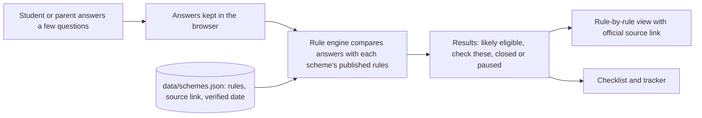

<div align="center">

# Haq Sahayak

### "Claim What's Yours": check which Andhra Pradesh education schemes you can claim, in Telugu and English

[](https://haq-sahayak.vercel.app)


Built for **Codebenders ACE Builders 2026**, Problem Statement 5.

</div>



---

## Contents

- [The problem](#the-problem)
- [What it does](#what-it-does)
- [Screenshots](#screenshots)
- [How it works](#how-it-works)
- [Schemes covered](#schemes-covered)
- [Privacy](#privacy)
- [Project structure](#project-structure)
- [Run it locally](#run-it-locally)
- [Honest notes and known issues](#honest-notes-and-known-issues)
- [Author](#author)

## The problem

Scheme rules are long, scattered across several portals, and hard to read. Many Andhra Pradesh families do not know which education schemes they can claim, so money and support go unclaimed.

## What it does

A student or parent answers a few simple questions, one at a time. **Every question can be skipped** with "Not sure". The app then shows:

- which schemes the family is **likely eligible** for
- which schemes need a **check** on the official portal
- which schemes are **closed or paused**
- every rule of each scheme and whether the answers **meet it**
- the **official source link** and the date the scheme was last verified

A **checklist** and a **tracker** help the family follow up on the official portal.

**Live site:** https://haq-sahayak.vercel.app

## Screenshots

All results shown below are for a made-up sample student. They are not real people.

| English | Telugu |
|---|---|
|  |  |
| **Results summary** | **Rule by rule** |
|  |  |

## How it works



- **A rule engine decides eligibility, not AI.** Each scheme's published rules are written as data, and the answers are checked against them. The same answers always give the same result.
- **Scheme data lives in [`data/schemes.json`](data/schemes.json).** Every scheme carries its official source link and a "last verified" date.
- **Telugu and English.** All interface text comes from `messages/en.json` and `messages/te.json`.
- **No accounts.** Your answers stay on this device.

The full specification is in [`SPEC.md`](SPEC.md).

## Schemes covered

| Scheme | Official source |
|---|---|
| AP Post Matric Scholarship: Fee Reimbursement (RTF) | [jnanabhumi.ap.gov.in](https://jnanabhumi.ap.gov.in) |
| AP Post Matric Scholarship: Food and Hostel (MTF) | [jnanabhumi.ap.gov.in](https://jnanabhumi.ap.gov.in) |
| Thalliki Vandanam | [tirupati.ap.gov.in](https://tirupati.ap.gov.in) |
| AP Pre-Matric Scholarship | [jnanabhumi.ap.gov.in](https://jnanabhumi.ap.gov.in) |
| PM-USP Central Sector Scheme of Scholarship for College and University Students | [scholarships.gov.in](https://scholarships.gov.in) |
| AICTE Pragati Scholarship for Girls (technical education) | [aicte.gov.in](https://www.aicte.gov.in) |

Each scheme's status on the site (for example "closed") is checked against these official sources. The data was last checked on **21 Nov 2026**. Rules and dates change, so always confirm on the official portal before applying.

## Privacy

- There are **no accounts and no sign-in**.
- Answers stay in your browser's local storage (`haq.profile`, `haq.ready`, `haq.tracker`). They are never uploaded.
- The **Clear my data** button removes them.
- Full text is on the in-app Privacy and Terms pages.

## Project structure

```
app/          Pages: landing, check, results, checklist, tracker, privacy, terms
components/   Interface components
data/         schemes.json, the scheme rules and sources
lib/          Shared logic
messages/     en.json and te.json, all interface text
tests/        Vitest tests
SPEC.md       Project specification
```

## Run it locally

You need Node.js 18.18 or newer.

```bash
npm install
npm run dev        # opens at http://localhost:3000
npm test           # runs the Vitest tests
npm run build      # production build
```

## Honest notes and known issues

- This is an **independent project**. It is not affiliated with the Government of Andhra Pradesh and does not submit any application.
- The sample students shown in the app (for example "Sample Lakshmi") are **made up** and labelled as samples.
- The Telugu text has **not yet been reviewed by a native speaker**.
- Some landing-page text still appears in English when Telugu is selected.
- On very narrow phone screens the landing page can scroll sideways slightly.
- Planned next: an "answers used" summary on the results page and clearer status labels in the scheme list.

## Author

**Shaik Hafreed**, solo builder. GitHub: [@ShaikHafreed](https://github.com/ShaikHafreed)
